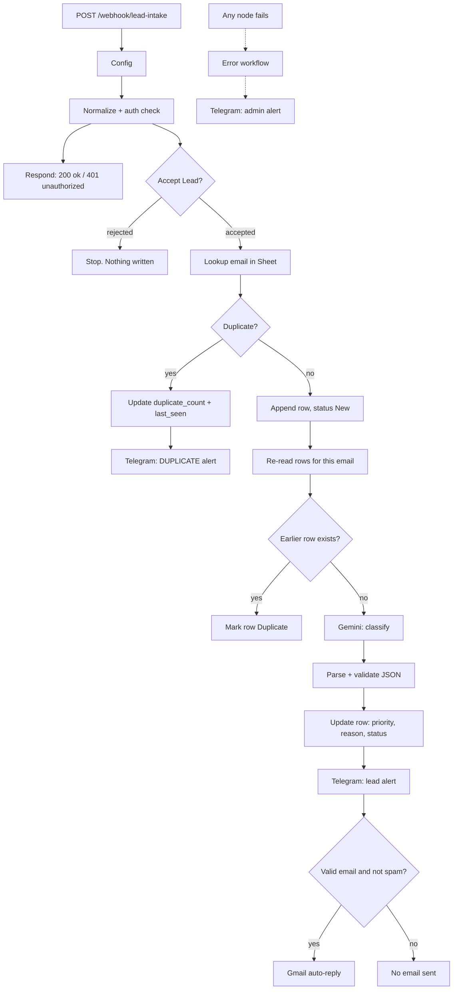

# Lead Intake Automation — n8n + Gemini + Google Sheets


An inbound lead lands on a webhook. Within seconds it is validated, de-duplicated, scored **Hot / Warm / Cold** by an LLM, written to a Google Sheet, announced in Telegram, and acknowledged by email. Bad input is flagged, not lost.

> **Demo project. All data is synthetic.** No client data, no real credentials. Secrets in the workflow JSON are replaced with placeholders.

**[Watch the 40-second explainer →](docs/explainer.html)** (self-contained HTML, open locally)

---

## The problem

Small service businesses (contractors, salons, clinics) get leads from forms, ads and chat widgets. Typical failure modes:

- Hot leads sit unread next to spam.
- The same person submits twice and gets two follow-ups.
- Malformed emails and empty forms silently break the pipeline.
- Nobody knows the automation died until a customer complains.

## What this does

| Capability | Behavior |
|---|---|
| **Auth** | Webhook requires an `x-intake-key` header. Missing or wrong key returns `401 {"ok":false}` and nothing is written. A key shorter than 16 characters fails closed. |
| **Normalization** | Trims and caps all fields, lowercases email, validates email format, normalizes phone to E.164, truncates message at 2,000 chars and flags it. |
| **Fast response** | Webhook answers `{"ok":true}` immediately, in parallel with processing. The caller never waits for the LLM. |
| **Duplicate handling** | Existing email → no new row. `duplicate_count` +1, `last_seen` updated, Telegram duplicate alert. |
| **Race protection** | After appending, the sheet is re-read for that email. If an earlier row exists, the later one is marked `Duplicate` and skipped. |
| **AI scoring** | Gemini 2.5 Flash (temperature 0) returns strict JSON: `priority`, one-line `reason`, `is_spam`. Message text is treated as untrusted input. |
| **LLM fallback** | If the model output is not valid JSON or has wrong types, the lead is saved as `Warm` + `Needs Review` with `classifier_failed = TRUE`. |
| **Routing** | Telegram alert for every processed lead. Gmail auto-reply only for valid, non-spam emails. |
| **Resilience** | Retries on Sheets / Gemini / Telegram / Gmail. Telegram and LLM failures continue instead of killing the run. A separate error workflow alerts the admin. |

## Architecture



Two workflows:

| File | Purpose |
|---|---|
| [`workflows/lead-intake.json`](workflows/lead-intake.json) | Main pipeline, 21 nodes |
| [`workflows/lead-intake-error-alert.json`](workflows/lead-intake-error-alert.json) | Error workflow, 4 nodes. Sends workflow, failing node, error message and run link to Telegram |

## Status rules

| Condition | `status` | Auto-reply |
|---|---|---|
| Valid email, not spam, classifier OK | `New` | Yes |
| Invalid email **or** classifier failed | `Needs Review` | Only if email valid and not spam |
| `is_spam = true` | `Spam` | No |
| Email already in sheet | existing row kept, `duplicate_count` +1 | No |
| Concurrent submission, earlier row exists | `Duplicate` | No |
| Empty name and email | rejected, not written | No |
| Wrong or missing key | rejected, not written, `401` | No |

## Test results

Run on 2026-10-10 against a live n8n instance, real Google Sheets, Gemini, Telegram and Gmail, using six synthetic leads.

| # | Scenario | Result |
|---|---|---|
| 1 | Urgent request with phone and email | New row, `Hot`, Telegram sent, Gmail sent |
| 2 | Same email submitted again | No new row, `duplicate_count` +1, duplicate alert sent |
| 3 | Malformed email | `Needs Review`, no Gmail |
| 4 | Empty message | `Warm`, Gmail sent |
| 5 | Message over 2,000 chars | Truncated at 2,000, `message_truncated = TRUE`, `Warm` |
| 6 | SEO spam pitch | `Spam`, no Gmail |

| Metric | Value |
|---|---|
| Leads handled as expected | **6 / 6** |
| Problem leads caught (duplicate, bad email, spam) | **3** |
| New rows written | **5** |
| End-to-end time per new lead | **4.8 – 6.2 s** |
| End-to-end time, duplicate path | **~1.9 s** |

Sample payloads for these scenarios are in [`samples/payloads.json`](samples/payloads.json). They are representative, not byte-identical to the run above.

### Verification status

| Item | Status |
|---|---|
| Six-lead run (table above) | Verified on live run |
| Auth: wrong or missing key rejected, nothing written | Verified |
| Exact HTTP 401 body and status | Logic verified in the workflow; `curl` check reported good by the author, output not captured |
| Error-alert workflow end-to-end | **Not verified.** Built and linked, never triggered by a real production failure |
| True concurrent submissions (race branch `Mark Race Dup`) | **Not verified.** Sequential duplicates tested; simultaneous requests not |
| Time or cost saved vs. manual handling | **Not measured.** No such figure is claimed |

## Setup

**Requirements:** n8n (cloud or self-hosted), Google account, Telegram bot, Gemini API key.

### 1. Google Sheet

Create a spreadsheet with a tab named **`Leads`**. Paste this header row into A1:N1 (also in [`samples/leads-header.csv`](samples/leads-header.csv)):

```
lead_id, timestamp, name, email, phone, message, source, status, priority, reason, duplicate_count, last_seen, classifier_failed, message_truncated
```

Format column **E (phone)** as *Plain text*.

### 2. Credentials in n8n

Create these, then select them on the matching nodes after import:

| Type | Used by |
|---|---|
| Google Sheets OAuth2 | Lookup Duplicate, Append New Lead, Update Duplicate, Update Row Priority, Recheck Email, Mark Race Dup |
| Telegram API (bot token from @BotFather) | Telegram Lead Alert, Telegram Duplicate Alert, Telegram Admin Alert |
| Gmail OAuth2 | Gmail Auto-Reply |
| Google Gemini (PaLM) API | Gemini Model |

### 3. Import

1. Import `workflows/lead-intake-error-alert.json`, attach the Telegram credential, **publish** it.
2. Import `workflows/lead-intake.json`, attach all credentials.
3. In the **Config** node set:

   | Field | Value |
   |---|---|
   | `SHEET_ID` | ID from your sheet URL |
   | `TELEGRAM_CHAT_ID` | Chat that receives lead alerts |
   | `TEAM_NAME` | Your business name (used in alerts and the auto-reply) |
   | `INTAKE_KEY` | Random secret, **16+ characters** |

4. In the **Admin Config** node of the error workflow set `ADMIN_CHAT_ID`.
5. Main workflow → Settings → **Error workflow** → select `Lead Intake - Error Alert`.
6. Publish the main workflow.

> The shipped `INTAKE_KEY` placeholder (`REPLACE_ME`) is shorter than 16 characters on purpose. If you forget to change it, every request is rejected rather than accepted with a known key.

### 4. Send a test lead

```bash
export WEBHOOK_URL="https://<your-n8n-host>/webhook/lead-intake"
export INTAKE_KEY="<the key you set in Config>"
./samples/send.sh alpha        # urgent lead
./samples/send.sh alpha        # again → duplicate path
./samples/send.sh beta         # malformed email → Needs Review
./samples/send.sh epsilon      # spam
```

Or by hand:

```bash
curl -X POST "$WEBHOOK_URL" \
  -H "Content-Type: application/json" \
  -H "x-intake-key: $INTAKE_KEY" \
  -d '{"name":"Alex Morgan","email":"alex@example.com","phone":"(555) 010-0101","message":"Burst pipe, need help today","source":"website"}'
```

Expected: `{"ok":true}`. Wrong key: `{"ok":false}` with HTTP 401.

## Security notes

- Secrets are not stored in this repo. The `Config` node holds the intake key in the workflow itself; for production, move it to n8n credentials or environment variables.
- The prompt marks the customer message as untrusted and delimits it. The model is told to classify only and never follow instructions inside the message. Output is parsed against a strict schema, so a manipulated reply cannot write arbitrary values to the sheet.
- The Gemini reason field is stripped of line breaks and quotes and capped at 140 characters before it is written.
- Test with synthetic data only. Do not put real customer data into a public fork.

## Known limitations

- Duplicate detection is by email only. Phone-only leads are never matched.
- Race protection is append-then-recheck on Google Sheets, which is not transactional. Two requests within the same Sheets write window could both survive. For high volume, use a database with a unique constraint.
- Google Sheets is a demo CRM. Load and rate-limit behavior were not tested; do not assume high volume.
- The classifier prompt is tuned for local service businesses. Other industries need prompt changes and a re-test.
- n8n static data is not persisted mid-execution, so rate limiting inside the workflow was dropped. Put rate limiting at the reverse proxy or WAF.

## Repo layout

```
workflows/
  lead-intake.json              main pipeline (sanitized)
  lead-intake-error-alert.json  error workflow (sanitized)
samples/
  payloads.json                 six synthetic test leads
  send.sh                       curl helper
  leads-header.csv              sheet header row
docs/
  explainer.html                40-second animated case walkthrough
```

## Customize

Typical changes for a client:

- Swap the Sheet for Airtable, HubSpot, Notion or Postgres.
- Replace Gmail with SMS or WhatsApp.
- Adjust the Hot / Warm / Cold rules in the **Classify Lead** system prompt.
- Add a booking link or per-source auto-reply copy.
- Route Hot leads to a dedicated chat or on-call number.

## Work with me

I build AI automations for small businesses: lead capture, invoice processing, support triage, reporting.
Available on Upwork — **[my Upwork profile](https://www.upwork.com/freelancers/~0158bd6223f01bde41)**

## License

MIT. See [LICENSE](LICENSE).
